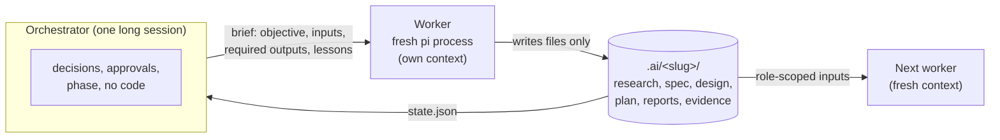
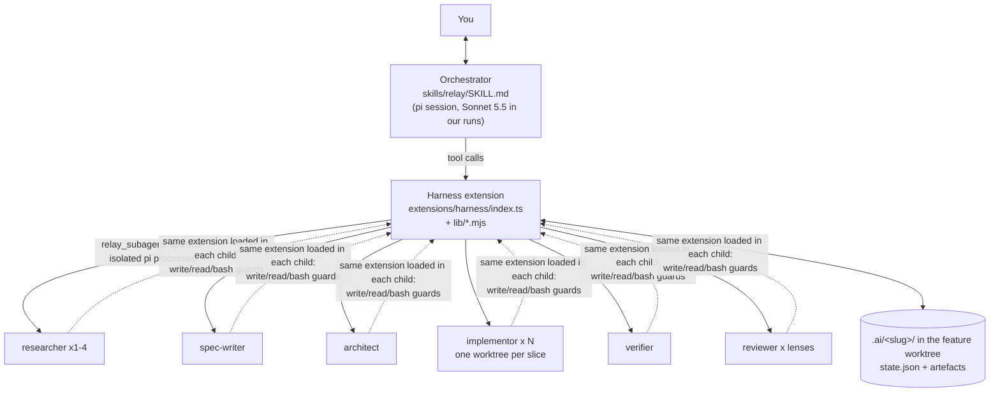

# Relay

**Relay turns a plain-English requirement into a reviewed, tested, ready-to-open pull request.** It coordinates a team of AI specialist agents and has the *harness* (code, not the model) enforce the rules.

It runs on the [pi coding agent](https://github.com/earendil-works/pi) today. Copilot is also supported through an installer (tested with the Copilot CLI; VS Code agent mode is untested), but only partly: agents, the skill and a guard hook are ported, while the `relay_*` gates are instruction-only there. See [Copilot port](#copilot-port) for what is verified and what is not.

## Contents

1. [Quickstart (30 seconds)](#quickstart-30-seconds)
2. [Why Relay](#why-relay)
3. [How Relay manages context](#how-relay-manages-context)
4. [Relay in 60 seconds](#relay-in-60-seconds)
5. [Architecture](#architecture)
6. [Before you start: expectations (when to use / not)](#before-you-start-expectations)
7. [Prerequisites and install](#prerequisites-and-install)
8. [Repo init (/relay-init)](#repo-init-relay-init) · [Multi-repo workspaces](#multi-repo-workspaces)
9. [Your first run](#your-first-run)
10. [The steps, one by one](#the-steps-one-by-one)
11. [Steering, resuming and finishing a run](#steering-resuming-and-finishing-a-run)
12. [Concepts and glossary](#concepts-and-glossary)
13. [Configuration](#configuration)
14. [Safeguards](#safeguards)
15. [Troubleshooting](#troubleshooting)
16. [FAQ](#faq)
17. [Worked example (docs/worked-example.md)](#worked-example)
18. [Contributing](#contributing)
19. [Repo layout and tests](#repo-layout-and-tests)
20. [Status and known limitations (incl. live status UI)](#status-and-known-limitations)
21. [Copilot port](#copilot-port)

## Quickstart (30 seconds)

```bash
pi install git:github.com/shankar029/relay   # npm (`pi install npm:relay-harness`) works only after the first npm publish, which has not happened yet
cd /path/to/your/repo               # a git repo with tests
pi
```
```
/relay-init                          # once per repo: scouts it, drafts AGENTS.md, configures checks (asks before writing)
/skill:relay Add todo archiving and a public HTML dashboard
```

Then edit `relay.config.json` so each tier maps to a model your pi can reach ([Configuration](#configuration)). Approve the spec and design when asked. Relay never pushes: you push and open the PR from `pr.md`.

## Why Relay
Asking one AI agent to "build this feature" works for small things. For anything bigger it tends to skip the spec, mark its own homework, forget tests, wander across unrelated files, and leave no trail you can audit or resume. Relay splits the job into roles, and the **harness (code, not the model) enforces the rules**. Each point below is enforced in code; follow the pointer to check it.

| Differentiator | What the code does | Where |
|---|---|---|
| **Evidence-gated passes** | Only the verifier can set a feature to `passes`, and a pass needs non-empty evidence files on disk. The orchestrator and implementors have no such tool. | `relay_set_passes` in `extensions/harness/index.ts`, `lib/gates.mjs`, `test/gates.test.mjs` |
| **Hidden holdout tests** | The spec-writer authors extra scenarios in `holdout/`; implementors and reviewers cannot read them. The verifier scores them; failures go back as one-line symptoms only. | `checkRead` in `lib/policy.mjs`, `lib/holdout.mjs`, `test/holdout.test.mjs` |
| **Disjoint file ownership, reverted if violated** | Parallel slices own disjoint files. Writes outside a slice's ownership are reverted after the worker finishes (bash included). | `enforceOwnership` in `lib/gitflow.mjs`, `checkPlan` in `lib/plan.mjs`, `test/gitflow.test.mjs` |
| **Human gates; push/PR only after you confirm** | You approve the spec and design (`relay_approval`). Relay commits artefacts locally and writes `pr.md`. Pushing and opening PRs is a separate final tool (`relay_pr`) that always asks you first, pushes only `relay/<slug>` (never force, never the default branch) and can be turned off with `pr.auto=false`. | `relay_approval`, `relay_pr` in `extensions/harness/index.ts`, `lib/prs.mjs`, `test/prs.test.mjs` |
| **Resumable on-disk state, per-feature worktrees** | State, artefacts and lock live in `.ai/<slug>/` inside a dedicated worktree and branch. A killed run resumes; interrupted workers are re-run. | `lib/state.mjs`, `lib/worktree.mjs`, `test/recovery.test.mjs`, `skills/relay/references/resume.md` |
| **Specialists in separate processes** | Each worker is a fresh pi process with a limited tool set and role guards. | `extensions/harness/run.ts`, `agents/*.md` |
| **Live stepper and worker UI** | A stage stepper and per-worker panel driven from on-disk status, plus a read-only live worker viewer (`alt+w`). | `lib/status.mjs`, `extensions/harness/watch.ts`, `test/status.test.mjs` |
| **Portable formats** | Agent Skills (`skills/relay/SKILL.md`), `agents/<name>.md`, a pi extension, and a Copilot installer (partly verified; see [Copilot port](#copilot-port)). | `lib/copilot.mjs`, `scripts/gen-copilot-agents.mjs` |

No benchmark or accuracy claims are made here: we have not measured Relay against other tools.

## How Relay manages context

Long agent sessions degrade as the conversation fills with code and tool output. Relay's design keeps each context small and moves state to disk. This section describes only what the code does.



- **Small orchestrator.** It holds decisions and phase, not code; it may write only `requirement.md`, `decisions.md`, `pr.md` and `lessons.md` (`checkWrite`, `lib/policy.mjs`).
- **Workers are fresh processes.** `runAgent` in `extensions/harness/run.ts` starts a new pi process per task with `--no-session`: a worker sees only its brief and the files it reads, never the orchestrator's conversation.
- **Artefacts are the hand-off.** Research is written once to `.ai/<slug>/research*.md` and reused by the architect and implementors instead of being re-derived. Layout is enforced by `isLayoutFile`; stray files are quarantined.
- **Role-scoped inputs.** The brief lists the files each role reads; the read guard blocks the rest (e.g. holdout is hidden, the spec-writer cannot read `README.md`) (`checkRead`).
- **Injected required outputs.** `relay_subagent` appends the exact files and JSON schemas a worker must produce, so briefs do not need to restate them.
- **Role-scoped lessons.** Past failures recorded in `.ai/lessons.md` are filtered per role (`lessonsFor`, `lib/lessons.mjs`) and injected into that role's brief only.
- **Resume from disk.** `harness_state open` rebuilds the picture from `state.json` and the artefacts (`skills/relay/references/resume.md`).

**Honest limits.** The orchestrator's own conversation still grows over a long run. What exists today: `resume.md` says the orchestrator *may* end its session at a phase boundary and be restarted with `/skill:relay --resume <slug>`, because nothing needed lives only in the conversation. Relay does **not** restart or compact the orchestrator for you, does not measure its context use, and the extension has no compaction logic of its own. pi's own auto-compaction (shown in its footer) is outside Relay's control. We make no numeric claims about context savings.

## Relay in 60 seconds

```mermaid
flowchart LR
  R[Requirement] --> B[Baseline checks]
  B --> RS[Research<br/>1-4 parallel topics]
  RS --> SP[Spec + hidden<br/>holdout scenarios]
  SP --> A1{{You approve spec}}
  A1 --> D[Design + slice plan]
  D --> A2{{You approve design}}
  A2 --> I[Implement slices<br/>parallel where independent]
  I --> V[Verify<br/>evidence + holdout score]
  V --> RV[Review<br/>parallel lenses]
  RV --> PR[pr.md + commit<br/>relay_pr after confirm]
```

You give Relay a requirement. An **orchestrator** (the `relay` skill) walks a fixed pipeline. It hands each step to a **specialist agent** that runs as its own isolated pi process. You approve the spec and the design. Everything is written to `.ai/<slug>/` inside a dedicated git worktree for the feature, and is committed there.



Relay prepares `pr.md`, then (only after you confirm in `relay_pr`) pushes `relay/<slug>` and opens the PR with `gh`.

## Architecture



- The **orchestrator** is an LLM following `SKILL.md`. It decides, delegates and talks to you. It cannot approve things for you.
- The **harness extension** provides the tools the orchestrator uses (`harness_state`, `relay_subagent`, `relay_approval`, `relay_checks`, `relay_secret_scan`, `relay_set_passes`) and loads into every child process to enforce guards.
- **Workers** are Markdown agent definitions in `agents/`. Each runs in a fresh pi process with a limited tool set.
- **`lib/*.mjs`** holds the logic (state, gates, policy, git flow, holdouts, fan-out). It has no dependencies and is unit-tested.

## Before you start: expectations

- **Time and cost.** Run 14 (an audit trail plus webhooks feature on a small Node API) took about **36 minutes** and about **4.9M tokens** over 14 delegated calls (from `state.json`: 09:39Z to 10:15Z). It is a real multi-agent run, not a quick edit. That is one data point, not a benchmark.
- **Budget.** The default config caps a run at 60 delegated calls (`budget.maxSubagentCalls`). You can also set `maxTokens`.
- **Approvals.** At the default `gated` level you are asked to approve the spec and the design.

**When to use Relay**

- Multi-file features where you want a written spec, a reviewed design, tests, independent verification and an auditable trail.
- Work you may need to pause, kill or resume, or hand to someone else via `.ai/<slug>/`.
- Repos with runnable tests, where "done" can be checked by evidence.

**When not to use Relay**

- Tiny changes (typo, one-line fix, rename): a normal agent session is faster.
- Exploratory or unclear work where you do not yet know what you want.
- Repos with no automated tests and no way to run them: the verifier and test gate lean on runnable checks.
- Anything you cannot afford to spend tokens on.
- Production-critical changes without a human reading the diff. Relay output still needs your review.

## Prerequisites and install

- Node 20+ and git.
- The [pi coding agent](https://github.com/earendil-works/pi) installed, with a provider logged in (`/login` inside pi).
- A target git repo with a way to run its tests (usually `npm test`).

```bash
git clone <this repo> relay && cd relay
npm install
npm run check            # confirms Relay itself is healthy
pi --list-models         # confirm pi can see models for your tiers
```

**Confirm the setup works:** `npm run check` should end with validate OK, all tests passing and a clean typecheck. Then pick models: `pi --list-models` lists what pi can reach.

Edit `relay.config.json` so each tier maps to a model you can use (see [Configuration](#configuration)). The shipped file maps all three tiers to `github-copilot/gpt-6.1-sol`, which only works if your pi can reach that model.

## Your first run

There is one path: run pi in the repo you want to change, with the Relay extension and skill loaded.

```bash
cd /path/to/your/repo                       # a clean git repo with tests
pi        # if installed via `pi install`; from source: pi -e /path/to/relay/extensions/harness/index.ts --skill /path/to/relay/skills/relay
```

Then, inside pi:

```
/skill:relay Add todo archiving and a public HTML dashboard
```

Relay creates branch `relay/<slug>` and a worktree at `<repo>.relay-worktrees/<slug>` (your working copy is untouched), runs the baseline checks, and starts.

**Unattended alternative (the live driver).** `scripts/live-run.mjs` runs the same orchestrator in pi's RPC mode with a single prompt. It is how our test runs were done:

```bash
node scripts/live-run.mjs <repo> <provider/model> "<requirement>" [--log run.log] [--nudges N] [--simulate-approvals]
```

- The model argument is the **orchestrator**. Specialists use `tiers` from `relay.config.json`.
- Approvals are asked on stdin (`Approve? [y/N]`). With no TTY they are denied.
- `--simulate-approvals` auto-approves and logs `[SIMULATED APPROVAL]`. Use it only for unattended tests, because it removes the human check.
- `--nudges N` sends up to N generic "continue" messages if the orchestrator stops early.
- The driver tells the orchestrator not to ask questions, so use interactive pi when you want to steer.

Relay looks for `relay.config.json` in the current directory first, then in the Relay repo. Agents are always read from the Relay repo's `agents/`.

## The steps, one by one

| # | Step | Input | What it does | Output |
|---|---|---|---|---|
| 0 | baseline | repo | runs the repo's own checks (`relay_checks`); asks you if they are already red | `state.json` check results, `evidence/checks-*.log` |
| 1 | requirement | your text | records and sizes it | `requirement.md`, `decisions.md` |
| 2 | research | requirement, `AGENTS.md`, README | read-only mapping; one researcher for small features, 2-4 parallel topic lanes otherwise; every claim cites `file:line`; orchestrator merges and lists conflicts and gaps | `research-<topic>.md` then `research.md` |
| 3 | spec | requirement, research | spec writer produces the spec, visible scenarios and hidden holdouts; spec-lint warns about vague wording | `spec.md`, `features.json`, `holdout/scenarios.json` |
| 4 | spec approval | spec, features | **you** approve or send feedback (max 3 rounds) | `state.approvals.spec` |
| 5 | design | spec, features, research | architect writes slices, file ownership, contracts and test paths | `design.md`, `design.html`, `plan.json` |
| 6 | design review and approval | design, plan | orchestrator compares design to spec; **you** approve (max 3 rounds) | `state.approvals.design` |
| 7 | implement | plan, design, spec | one implementor per slice; independent slices in parallel, each in a sub-worktree, merged back in plan order; test gate | code and tests, `reports/impl-<slice>.md` |
| 8 | verify | spec, features, plan | verifier checks each scenario against the running code, saves evidence, sets `passes`, scores holdouts | `evidence/**`, `reports/verify-*.json`, `holdout/results.json` |
| 9 | review | diff, spec, design | required checks first; one reviewer per lens in parallel; consolidate; re-run only blocking lenses (max 2 rounds) | `reports/review-<lens>.json`, `review-consolidated.json`, `review.md` |
| 10 | pr | everything | writes PR text, runs secret scan, commits `.ai/<slug>/`, marks `done` | `pr.md`, a commit on `relay/<slug>` |

**What to check at each approval**

- *Spec:* every requirement has a concrete, observable scenario in `features.json`. Open questions are flagged, not guessed. Holdout scenarios are deliberately hidden from you too.
- *Design:* slices do not overlap on files, each code slice lists its tests, third-party APIs are faked with a mock or twin (see `skills/relay/references/digital-twins.md`).

## Repo init (`/relay-init`)

Run once per repo (and with `--refresh` later) before your first feature: `/relay-init` in pi, or `/skill:relay --init [--refresh]`. It starts no feature. The flow is in `skills/relay/references/init.md`; the logic is in `lib/init.mjs` and the `relay_init` tool.

1. **Preflight.** Needs a git repo with at least one commit; if not, it offers `git init -b main` plus an initial commit (asks first). Reports dirty tree, detached HEAD, default branch, remotes (optional).
2. **Detect** (file-based, no guessing): stacks, apps and their kind (browser UI / API / CLI / library), package manager, candidate build/test/lint/typecheck/run commands, test frameworks, ports, runtime version pins vs your Node, docker compose services, CI files (and local-vs-CI check mismatches), git hooks, gitleaks/semgrep availability, `.env` files, third-party SDKs, mobile/desktop shells.
3. **Repo scout.** A read-only specialist (`agents/relay-repo-scout.md`) runs the candidate commands and drafts `AGENTS.md`. The harness gate (`scoutProblems`) rejects the draft unless every command marked `verified` has exit code 0 and a non-empty log under `.ai/repo-init/evidence/`, and every `not-run` has a reason.
4. **You approve every write.** `AGENTS.md` (shown in full or as a diff; an existing file is never overwritten: only a marked `relay:init` block is added or replaced), `.gitignore` entries (`.ai/*/holdout/`, locks, quarantine, tool `node_modules`, `.env*`), and `relay.config.json` (only missing keys: detected `checks`, `requiredChecks`, `autonomy`, `budget`, `verifier`). These prompts are always interactive, even at `autonomy=autonomous`.
5. **Verifier tooling (browser UIs, with consent).** Installs Playwright + Chromium into `.relay/tools` (its own `package.json`; your dependencies and lockfiles are untouched) and runs a smoke screenshot. Verifier tasks then get the absolute helper path (feature worktrees do not contain untracked tool dirs). API repos need nothing installed; CLI/library/mobile get notes about limits. Linux browser OS libraries (`playwright install-deps`, needs sudo), gitleaks/semgrep, docker services, hooks and CI are reported, never changed.
6. **Baseline** (optional, confirmed) runs the detected checks and stores logs; destructive-looking commands are skipped. **Commit** (confirmed) stages only the files init wrote and never pushes. A summary report is written to `.ai/repo-init/init-report.md`.

Re-running is idempotent: unchanged files produce no diff and no prompt.

**Verified vs not.** Unit tests: `test/init.test.mjs` (preflight, detection, merge/diff, gitignore/config idempotence, scout gate, baseline, scout write policy). Live, real pi TUI on Windows with approvals simulated by pressing Enter on each dialog (so the human check was not exercised), on a browser-UI sample (todo web app, initially not a git repo): git bootstrap, scout run (about 6 min, passed the gate, evidence logs written), AGENTS.md/.gitignore/relay.config.json approvals, baseline and commit all worked. That run exposed a bug: the npm feed's latest Playwright tag pointed at an alpha whose playwright-core was missing (ETARGET); install_verifier now retries with the newest stable version (latestStable, unit-tested). After that fix, Playwright 1.65 plus Chromium and a screenshot were verified by hand in .relay/tools, but the full tool-driven install plus smoke step was not re-run end to end. A --refresh re-run reached the scout and failed with model_not_supported on the sample's default mid tier, so refresh idempotence was not verified live (pin 	iers.mid in relay.config.json); idempotence is covered by unit tests only. Not verified: an API-only repo live, macOS/Linux, the Copilot port of init, non-Node stacks beyond unit-level detection, Python/Go/Rust command discovery on real repos, docker compose and CI detection on real repos, `--refresh` on large repos.

## Multi-repo workspaces

If you start Relay in a directory that is **not** a git repo but has child git repos (the usual "parent folder with everything cloned" layout), it runs in workspace mode. Single-repo behaviour is unchanged. Design and limits: [docs/multi-repo.md](docs/multi-repo.md); code: `lib/workspace.mjs`.

- **Per-feature container.** `<workspace>/.relay-features/<slug>/` is a tiny local-only git repo holding `.ai/<slug>/` (spec, design, plan, evidence, state). Agents run there, so every path is repo-qualified (`api/src/server.js`) and ownership globs, holdouts and guards work as before.
- **Lazy per-repo worktrees.** Only repos the plan touches get a worktree `<container>/<repo>` on branch `relay/<slug>`; your main checkouts are never written.
- **Slices carry a `repo`.** Ownership, test gate, checks (`<repo>:test`), merges and the status UI's `[repo]` tag are per repo. A slice covers one repo; cross-repo contracts and ordering go in the design.
- **Config.** `relay.config.json` may set `workspace.repos` / `workspace.exclude` and per-repo `checks` (`{"api": {"test": "npm test"}}`).
- **Finish.** One `pr-<repo>.md` per repo plus a feature-level `pr.md`, cross-linked. `relay_pr` then pushes each repo's `relay/<slug>` and opens one PR per repo (after your confirmation), cross-linking the siblings.
- **Init at the parent folder.** `/relay-init` in the workspace root: `relay_init action=workspace_plan` shows each repo's init status; the orchestrator runs the normal per-repo init (repo scout, verifier tooling, `.gitignore`, baseline, commit) for each repo via `repo=<name>`, then writes the root `relay.config.json` (adds only missing keys: `workspace.repos`, `workspace.exclude`, per-repo `checks`, `requiredChecks`, `autonomy`, `budget`; never overwrites yours) and a workspace `AGENTS.md` (repo map, roles, inter-repo links with evidence, per-repo commands, suggested change order) in a marked block after you approve a diff. Child repos not listed in `workspace.repos` are reported, never touched. `--refresh` re-runs it. Logic: `lib/wsinit.mjs`.

**Verified vs not.** Unit tests: `test/workspace.test.mjs`. Live (real pi TUI, Windows, `gpt-6.1-sol` for orchestrator and workers, approvals simulated by pressing Enter) on a two-repo workspace (node API + client) with one cross-repo feature: lazy worktrees, `repo`-tagged slices, kill -9 during implementation followed by `--resume` (interrupted slice re-run, both repo worktrees re-attached), review, verify, and `pr*.md` all completed; main checkouts stayed untouched; I re-ran both repos' tests in the worktrees (16/16, 10/10). The run exposed a bug (review gate could not be satisfied for repo-qualified checks), fixed and re-verified by resuming the same feature. Workspace-level init: the root steps (workspace_plan, config, workspace AGENTS.md) were run live in a pi TUI on a copy of the two-repo sample (approvals simulated with Enter) and wrote the expected files; the per-repo scouts of a workspace init, `--refresh` at the root and a 3+ repo workspace were not run live (unit-tested: `test/wsinit.test.mjs`). Roles and links are heuristics from manifests/ports/paths (the sample's API was classified as a library and no link was found), so review the generated AGENTS.md. Not verified: macOS/Linux, parallel slices across repos live (unit-tested only), the Copilot guard/installer in containers (cwd-based, not adapted), dirty main checkouts (not included in worktree bases), `node_modules` in repo worktrees (not copied), slices spanning several repos.
## Steering, resuming and finishing a run

**Answer clarifying questions.** Reply in the pi chat. Relay records the question in `state.json` (`pendingQuestions`) and your answer in `decisions.md` so it survives a restart.

**Request changes to the spec or design.** Decline the approval prompt and say what to change ("add an error case for empty input"). Relay re-delegates with your feedback, up to 3 rounds per gate, then escalates.

**Resume an interrupted run.**

```
/skill:relay --resume [slug]
```

With no slug it lists `relay/*` worktrees. Relay re-attaches to the worktree, checks artefact hashes and re-runs interrupted steps (details: `skills/relay/references/resume.md`). Worktree re-attach is unit-tested; a full kill-and-resume of a real run has **not** been done live.

**Finish: open the PR(s).** After `finalize`, the orchestrator calls `relay_pr plan` and `relay_pr open`. `open` shows one line per repo (branch, head, remote, diff size) and asks you to confirm; it needs an interactive UI and runs regardless of autonomy.

- Pushes only `relay/<slug>` (`git push -u origin relay/<slug>:relay/<slug>`, never `--force`, refuses any other branch name).
- One PR per repo via `gh pr create`, body from `pr.md` (single repo) or `pr-<repo>.md`; sibling PRs are cross-linked by editing each body once all exist.
- URLs are recorded in `state.json` under `prs`. Re-running is idempotent: a recorded PR, or an open PR for the head branch, is reused.
- No `gh`, no `origin` remote, or a push failure: that repo is reported and its `pr*.md` is left for you; other repos continue.
- Disable with `relay.config.json`: `{"pr": {"auto": false}}` (draft PRs: `"draft": true`).

Manual fallback: `git push -u origin relay/<slug>` then `gh pr create --body-file .ai/<slug>/pr.md`.

Verified: the push/create/cross-link/idempotency path ran against two real throwaway GitHub repos (see `test/prs.test.mjs` for the mocked-`gh` unit tests). **Not** verified: the interactive `relay_pr` confirmation inside a full pi run (the logic was driven directly), GitHub Enterprise, protected-branch rules or required-reviewer setups, fork workflows. The holdout directory is never committed. Clean up with `git worktree remove <path>`.

## Concepts and glossary

- **Slice** – one unit of implementation work in `plan.json`: an id, the files it owns, its spec items, its tests and its dependencies. One implementor handles one slice and may only write files the slice owns.
- **Wave / parallel slices** – slices with disjoint files and no dependencies run at the same time, each in its own sub-worktree (`relay/<slug>--<slice>`), then merge back in plan order.
- **Worktree** – a second checkout of your repo on its own branch (`relay/<slug>`) at `<repo>.relay-worktrees/<slug>`. All work and `.ai/<slug>/` live there.
- **Lane** – a named parallel task (a research topic or a review lens).
- **Lens** – one review perspective (correctness, security, tests, performance by default; accessibility for UI diffs; api-contract for endpoint changes). Each lens is a separate reviewer writing `reports/review-<lens>.json`.
- **Holdout** – hidden end-to-end scenarios (`holdout/scenarios.json`). Only the verifier may read them; implementors and reviewers never see them, so they cannot tune the code to the tests.
- **Satisfaction score** – the fraction of holdout scenarios that pass (run 14: 4/4). Reported next to, not instead of, the per-scenario `passes` gate, which stays authoritative. `satisfactionThreshold` (default 1) must be met to enter review.
- **Tier** – a capability level (`strong`, `mid`, `cheap`) that an agent declares. `relay.config.json` maps tiers to models, so no model IDs are in agent files.
- **Gate** – a check the harness runs before a phase change (`set_phase`): schemas valid, approvals recorded, slices merged, evidence present, required checks green on HEAD.
- **Guard** – a rule enforced when an agent reads, writes or runs bash.
- **Autonomy level** – how many approvals Relay asks for (`supervised`, `gated`, `autonomous`).
- **Digital twin / mock** – a fake of a third-party API used so tests never call the real one.

### The agents

| Agent | Job | Can write |
|---|---|---|
| `relay` (orchestrator) | Runs the pipeline, calls harness tools, merges research and review output | `.ai/<slug>/` coordination files |
| `relay-researcher` | Read-only investigation of one topic | `research-<topic>.md` |
| `relay-spec-writer` | Spec, `features.json`, holdout scenarios | spec files, `holdout/scenarios.json` |
| `relay-architect` | Design and slice plan | `design.md`, `design.html`, `plan.json` |
| `relay-implementor` | Code and tests for one slice | only the files its slice owns |
| `relay-verifier` | Checks with evidence; sets `passes`; scores holdouts | `evidence/**`, `reports/verify-*.json`, `holdout/results.json` |
| `relay-reviewer` | Reviews the diff through one lens | `reports/review-<lens>.json` |

### What ends up in `.ai/<slug>/`

```
.ai/<slug>/
  state.json        phase, worktree + branch, approvals, counters, usage
  requirement.md    decisions.md    research.md (+ research-<topic>.md)
  spec.md           features.json   design.md   design.html   plan.json
  evidence/         proof for each scenario and each check run
  reports/          impl-*.md, verify-*.json, review-<lens>.json, review.md
  pr.md             final PR text and traceability table
  holdout/          hidden scenarios + results (never committed)
  _quarantine/      stray files moved out of the way (not committed)
```

## Configuration

`relay.config.json` (this repo's copy is the default):

```json
{
  "reviewLenses": ["correctness", "security", "tests", "performance"],
  "autonomy": "gated",
  "requiredChecks": ["test"],
  "satisfactionThreshold": 1,
  "budget": { "maxSubagentCalls": 60, "maxTokens": 8000000 },
  "tiers": { "strong": "<provider/model>", "mid": "<provider/model>", "cheap": "<provider/model>" }
}
```

| Key | Meaning |
|---|---|
| `tiers` | tier to model. Required for specialists to run on a model you choose |
| `reviewLenses` | which lenses run. Accessibility and api-contract are added automatically for UI or endpoint diffs |
| `autonomy` | `supervised` (spec, design and PR text approved by you), `gated` (default: spec and design), `autonomous` (none; `relay_approval` auto-approves and says so). Schema, check, holdout and review gates apply at every level |
| `requiredChecks` | checks that must have run green on the current HEAD before review/PR (default `["test"]`; may include `lint`, `sast`) |
| `satisfactionThreshold` | minimum holdout pass fraction to enter review (default 1) |
| `budget` | optional `maxSubagentCalls` and `maxTokens`; delegation is refused once exceeded |

The `maxTokens` value above is an example; it is not set in the shipped file.

**Models on another machine.** Run `pi --list-models`. An unlisted id is still accepted with a "not found ... using custom model id" warning and works if the provider serves it. If the provider rejects pi's default API, add a custom entry in `~/.pi/agent/models.json`. Our live runs needed one for `claude-sonnet-5.5`:

```json
{ "providers": { "github-copilot": { "models": [
  { "id": "claude-sonnet-5.5", "api": "openai-completions", "baseUrl": "https://api.githubcopilot.com",
    "reasoning": false, "input": ["text"], "contextWindow": 200000, "maxTokens": 32000,
    "headers": { "User-Agent": "GitHubCopilotChat/0.35.0", "Editor-Version": "vscode/1.107.0",
                 "Editor-Plugin-Version": "copilot-chat/0.35.0", "Copilot-Integration-Id": "vscode-chat" } } ] } } }
```

This is what worked here, not a guarantee elsewhere. Never commit tokens.

## Safeguards

The harness enforces these in `extensions/harness/` and `lib/`. How far each one has been proven is in [Status and known limitations](#status-and-known-limitations); a guard being listed here does **not** mean it was exercised live.

- **One worktree per feature.** Branch `relay/<slug>` in `<repo>.relay-worktrees/<slug>`.
- **Write guards.** A role can only write its allowed files. `state.json`, `AGENTS.md`, `README.md`, `.env` and `.git` are protected. Agents cannot run `git push` (blocked in bash); only the harness's `relay_pr` pushes, and only `relay/<slug>`. Only implementors may commit.
- **Ownership revert.** After a child run, the harness diffs against the pre-run HEAD and reverts out-of-ownership changes, including ones made through `bash`.
- **Bash path confinement.** A pattern-based block on bash writes outside the worktree. Heuristic: it can be bypassed.
- **Holdouts.** Read guards block every role except the verifier and spec-writer, including bash commands that mention the directory. The orchestrator is told never to read or quote them. Obfuscated reads (for example string-built paths) are not reliably caught.
- **Test gate.** An implementor slice that changes code without touching tests fails and is retried with feedback. Implementors must map each spec item in their slice to a named test (integration/e2e for API, UI or cross-module slices) and report it in `reports/impl-<slice>.md`. `plan.json` slices that list spec items but no `tests` are rejected at the design gate. The mapping report itself is instruction-only, not machine-checked.
- **Only you approve.** Approvals go through `relay_approval`. Only the verifier can set `passes`, and only with evidence. At `autonomous` level approvals are skipped by design.
- **Content gates.** `set_phase` checks schemas, recorded approvals, merged slices, evidence for each passing scenario and the review report, not just that files exist.
- **Required checks.** `requiredChecks` must be green on the current HEAD before review or PR.
- **Caps.** Implement, verify and review loops are counted and capped. Review lens re-runs are limited to 2 rounds. Exceeding a cap escalates to you.
- **Budget and usage.** Every delegated call records calls, turns and tokens in `state.usage`. Optional caps refuse further delegation.
- **Stray-file quarantine.** Files in `.ai/<slug>/` outside the allowed layout are moved to `_quarantine/` and not committed.
- **Secret scan.** Runs before the final commit. It is a pattern scan, not a guarantee.

## Troubleshooting

**A cap was hit** (`CAP EXCEEDED: escalate to the user` or `budget exceeded`). Relay stops and asks you. Look at the latest report in `.ai/<slug>/reports/` to see why the loop did not converge. To continue, either fix the cause by hand in the worktree or raise the cap (`budget.*` in `relay.config.json`; loop caps are set by the orchestrator when it opens each counter) and resume.

**Baseline is red.** Your repo's tests fail before Relay changes anything. Relay asks whether to continue. Fix the repo first: Relay's gates compare against green, and a red baseline makes failures ambiguous.

**Discard a run.** There is no discard command. Remove the worktree and branch yourself:

```bash
git worktree remove --force <repo>.relay-worktrees/<slug>
git branch -D relay/<slug>
git branch --list "relay/<slug>--*"      # delete leftover slice branches too, if any
```

**pi cannot find the model.** Check the id with `pi --list-models` and that the provider is logged in. An id pi does not list may still work as a custom id; if the provider returns an API error, add a `models.json` entry (see [Configuration](#configuration)). Check every tier in `relay.config.json`, not just the orchestrator.

**The run looks stuck.** The orchestrator sometimes stops early. In pi, type `continue`. With the driver, use `--nudges N`. If you get `lock held by pid ...`, another process owns the run; if that process is dead, confirm and resume with takeover (Relay asks). Check `state.json` `phase` and `pendingQuestions` to see where it is waiting.

**A child was rejected** (`FAILED`, `MISSING REQUIRED OUTPUTS`, plan errors). The harness tells the orchestrator what was wrong and it re-delegates. This is normal and counted against the caps.

## FAQ

**Does Relay push or open a PR?** Only as the last step, after you confirm: `relay_pr` pushes `relay/<slug>` (no force, never the default branch) and runs `gh pr create`. Set `"pr": {"auto": false}` in `relay.config.json` to keep it to `pr.md`.

**Does it change my working copy?** No. Work happens in a separate worktree. It does need to read your repo and `git worktree add` a new one.

**Which models does it use?** Whatever you map in `tiers`, plus the model you start pi with for the orchestrator. We ran Sonnet 5.5 for orchestration and GPT-6.1 Sol for specialists.

**Why can't implementors see the holdout scenarios?** So they cannot overfit to them. Only the verifier reads them and reports a score.

**Can the model approve its own spec?** Not through `relay_approval`, which is a human prompt. At `autonomous` autonomy approvals are skipped on purpose, and in simulated runs the driver auto-approves.

**Does it work without tests in the repo?** Poorly. The test gate and required checks expect runnable tests.

## Worked example

Real excerpts from run 14 (spec, design, traceability, review) are in [docs/worked-example.md](docs/worked-example.md).

## Contributing

First read `AGENTS.md`, then run `npm install` and `npm run check`.

**Add an agent.**
1. Create `agents/relay-<name>.md` with frontmatter `name` (equal to the filename), `description`, `tools` and `tier`. No model IDs.
2. Teach the harness the role: required outputs and write/read rules live in `lib/policy.mjs` (`requiredOutputs`, `checkWrite`, `checkRead`).
3. Reference it from `skills/relay/SKILL.md` where the orchestrator should use it.
4. Add tests in `test/` and run `npm run check` (it lints the frontmatter).

**Add a review lens.**
1. Add its checklist to `LENS_CHECKLISTS` in `lib/fanout.mjs`.
2. To make it automatic for certain diffs, extend `reviewLenses()` there. To make it always on, add it to `reviewLenses` in `relay.config.json`.
3. Lens names must be lowercase-hyphenated (`LANE_RE`). The lens JSON follows `schemas/review-lens.schema.json`.
4. Add a unit test.

**Add a check** (for example `lint`, `sast`). `relay_checks` runs the commands in `state.checks`; it autodetects `build`, `typecheck`, `lint`, `test` from `package.json` scripts and recognises `sast`. Add the check name to `requiredChecks` in `relay.config.json` to make it a gate. The orchestrator can set commands with `harness_state action=checks`.

**Change a file contract.** Schemas in `schemas/` are the contract for `.ai/<feature>/` files. Change them together with `lib/state.mjs`, the fixtures and the tests. Put logic in `lib/*.mjs` and keep `extensions/harness/index.ts` thin. pi APIs must come from the installed `@earendil-works/pi-coding-agent` types and docs.

## Repo layout and tests

| Path | Purpose |
|---|---|
| `skills/relay/` | Orchestrator skill. `references/` has brief, workflow, resume, scenario and digital-twin guidance |
| `agents/` | The agent definitions |
| `extensions/harness/` | pi extension: `relay_subagent` (single, parallel, chain), `harness_state`, `relay_approval`, `relay_checks`, `relay_secret_scan`, guards |
| `lib/` | Dependency-free ESM logic shared by the extension and tests |
| `schemas/` | JSON Schemas: state, features, plan, verifier report, review lens |
| `templates/` | brief, spec, design, lessons |
| `scripts/` | `validate.mjs`, `live-run.mjs`, `gen-copilot-agents.mjs` |
| `docs/copilot-port.md` | Copilot port plan and concept mapping |

```bash
npm run check   # validate (frontmatter + schemas) + node --test test/ + typecheck
```

## Status and known limitations

Relay has been run live in pi several times against small sample Node APIs, with Sonnet 5.5 as orchestrator and GPT-6.1 Sol as specialists. The most recent documented run (run 14, above) reached `done` with no nudges. Honest scope of the evidence:

- **Seen working live:** the pipeline through to a committed `pr.md`; parallel review lenses with citations; a blocking review finding fixed and the affected lens re-run; holdout scoring; the bash outside-worktree write block; the holdout read block against an implementor and against a reviewer's `read` tool; usage recording.
- **Unit-tested only, or checked outside a real model run:** the ownership revert and the test-gate retry through a real child agent; obfuscated holdout-read variants; the 2-round lens cap refusal; budget caps; autonomy levels; required `sast`/`lint` checks; the Windows `node_modules` junction; spec lessons; the digital-twin design gate; worktree re-attach on resume.
- **Not exercised in every run:** parallel researcher lanes and parallel slices depend on the orchestrator's and architect's choices. Run 14 used one researcher and two dependent (sequential) slices.
- **Approvals in the live runs were simulated** with `--simulate-approvals`. The stdin approval mode exists but a human-in-the-loop run has not been done end to end.
- **Pushing and opening PRs:** the `relay_pr` logic is verified against real throwaway GitHub repos and mocked-`gh` unit tests; the interactive confirmation inside a full pi run, GitHub Enterprise, protected branches and forks are untested. Resuming a killed real run is now verified (see Live status).
- The bash write guards and the holdout read guard are **pattern based** and can be obfuscated around (for example `python -c "open('../x','w')"`). The ownership revert is the backstop for writes inside the repo. Reads of ignored or untracked paths are not policed.
- Evidence comes from a few small sample repos and one platform (Windows). Results elsewhere are unknown. Token use and duration vary between runs.

## Live status and background workers

Inside an interactive pi session Relay shows progress and keeps the orchestrator free for questions.

- **Status panels.** A horizontal stepper (a node per stage joined by lines, label underneath, a detail line such as `Implementing 2/4 slices · 03:32`) sits above the editor; it scrolls around the current stage on narrow terminals and drops colour if `NO_COLOR` is set. A panel below the editor titles the current stage (`Implement · 2/4 done · 2 running`) with a progress bar, then one row per worker (state glyph, name, elapsed, tools, tokens) and a `▸ now doing` line for running ones. Failures sort first, extra rows collapse to `+N done`, and a key hint stays visible. A short footer status mirrors it. State comes from `state.json`, `.ai/<slug>/` files and a job registry on disk (`<git-dir>/relay/<slug>/jobs.json` plus per-worker JSONL logs, never committed), so it is rebuilt after a restart or resume.
- **Watch a worker.** Press `alt+w` or run `/relay-watch [worker]` for a live, read-only tail of a worker's tool calls and output. `Tab`/`←`/`→` switch worker, `↑↓`/`PgUp`/`PgDn` scroll, `f` follows, `Esc`/`q` returns to the orchestrator.
- **Background workers.** `relay_subagent` accepts `background: true` (or set `"background": true` in `relay.config.json`). The call returns at once, the orchestrator stays available, and a completion message starts its next turn. The `relay_jobs` tool (`list`, `tail`, `cancel`) lets it answer "what is it doing?". One implementor batch runs in the background at a time; ownership, test gate and budget checks are unchanged. `pi -p` runs have no UI, so they always run in the foreground.
- **What pi cannot do.** There is no screen-pinned top region (widgets sit above and below the editor and scroll with the chat), and no interactive attach to a worker: workers are separate `pi --mode json -p` processes, so the viewer is read-only.
- **Verified live (real pi 0.78.0 TUI in a Windows ConPTY, captured with pyte, real model gpt-6.1-sol):** the pipeline bar and step panel render and update about once a second; background start returns at once; a question typed while the worker runs is answered via `relay_jobs tail`; the completion message triggers a new orchestrator turn; `alt+w` opens the worker view, which tails live, switches worker with Tab (3 parallel researcher lanes), and Esc returns; after restarting pi the panels are rebuilt from disk. Earlier RPC-mode probes agree.
- **Stepper and redesigned panels:** rendered in the real TUI with colour, but the implement and review captures use job records seeded on disk (not live workers). Real parallel runs were only done for 3 researcher lanes, with the earlier panel layout.
- **Pause, resume and crash recovery:** `/relay-pause` stops new workers and aborts background batches, marks `state.paused` and shows `⏸ PAUSED`; `/relay-resume` clears it and tells the orchestrator to `open` and re-run interrupted work. `--resume` also recovers a crash-killed run: a dead-pid lock is taken over automatically, running steps and slices become `interrupted` (shown `⚠`), partial untracked work is stashed, and interrupted workers are re-run. A foreground worker cannot be aborted by `/relay-pause`; the pause takes effect before the next launch.
- **Verified live (run `notes-plus`, real pi TUI in ConPTY, gpt-6.1-sol, 3 real parallel implementors and 4 real parallel reviewers; approvals simulated by pressing Enter on Yes):** the stepper and worker panel in the real implement, verify and review stages; `taskkill /F /T` of the whole pi tree mid-implementation, then restart, where the persisted view showed all 3 slices `⚠ interrupted` and `--resume` re-ran them and completed the run to `done` with one merge per slice, no stash left and no stray processes; pause then resume (header `⏸ PAUSED`); `relay_jobs cancel` on the running review batch (4 reviewers shown `⊘`, then re-run). Screenshots are text renders of the real captures, not committed.
- **Bugs the live run found and fixed:** `/relay-resume` left `state.paused` on disk, and interrupted jobs inflated the stage timer.
- **Partial or not verified:** after `/relay-resume` the orchestrator sometimes needed a further nudge to continue; the orchestrator ran Sol, not Sonnet; a machine sleep inflated some timers; the kill was a whole-tree kill, so killing only the parent pi (leaving orphan workers) is untested; whether `cancel` kills a worker's grandchildren on Windows is unconfirmed; other terminals or OSes.

## Publishing

Publishing to npm is done by `.github/workflows/publish.yml` when a GitHub release is published (or by running the workflow manually). It runs `npm run check`, checks the package version matches the release tag, then runs `npm publish --access public --provenance`. One-time setup: create an npm automation or granular access token and save it as the repo secret `NPM_TOKEN`. Not yet run: the workflow has not been exercised.

## Copilot port

Relay can be installed into GitHub Copilot (CLI and VS Code agent mode). It is a weaker host than pi: the orchestrator follows Relay's rules by instruction, and only a `preToolUse` hook enforces anything.

### Install

```
npm run install:copilot -- --target repo --dry-run    # preview, writes nothing
npm run install:copilot -- --target repo              # into <cwd>/.github (agents, skills/relay, hooks, relay runtime)
npm run install:copilot -- --target home              # into ~/.copilot (or $COPILOT_HOME)
npm run install:copilot -- --target plugin --dest dist/copilot-plugin   # plugin.json package, then: copilot plugin install <dir>
```

Options: `--dest <dir>`, `--no-guard` (skip the hook). Then start with `copilot --agent relay`.

Tiers map to models through `copilotTiers` and `copilotOrchestrator` in `relay.config.json` (default: orchestrator `claude-sonnet-5.5`, specialists `gpt-6.1-sol`). Your Copilot plan or admin may override `model:`.

### Enforcement: pi vs Copilot

| Rule | pi | Copilot |
|---|---|---|
| Holdout/read/write guards | extension | hook, **subagents only** (root session has no `agentType`; set `RELAY_ROLE=relay` to guard it) |
| bash path confinement, `git push`/non-implementor commit block | extension | hook |
| Per-slice ownership revert | extension | instruction only (hook cannot see slice globs) |
| Test gate, phase gates, budget, review round cap, autonomy | extension (`relay_*` tools) | instruction only; state.json edited by hand |
| Workers as separate processes, parallel slice worktrees | yes | no; uses Copilot's `task`/`agent` subagents |

Details: [`skills/relay/references/copilot-host.md`](skills/relay/references/copilot-host.md), [`docs/copilot-port.md`](docs/copilot-port.md).

### Verified vs unverified

Verified live with the `copilot` CLI: skills are discovered from `.github/skills`; agents from `.github/agents`; the `relay-reviewer`/`relay-implementor` agents run as subagents; the `preToolUse` hook fires with the expected payload and identifies subagent roles; `copilot plugin install` of the generated plugin succeeds (CLI reported "Installed 1 skill"; agent loading from the plugin was not confirmed). Verified by unit tests: translation, tier mapping, installer and dry-run, the installed hook denying a reviewer reading holdout, and the guard decision matrix.

Unverified: an end-to-end Relay run on Copilot; hook denial live (in probes the model refused on its own, so no tool call reached the hook); the Sonnet orchestrator model (an admin setting forced `gpt-6.1-sol` here); VS Code agent mode; marketplace publishing (direct plugin installs are deprecated by Copilot).
