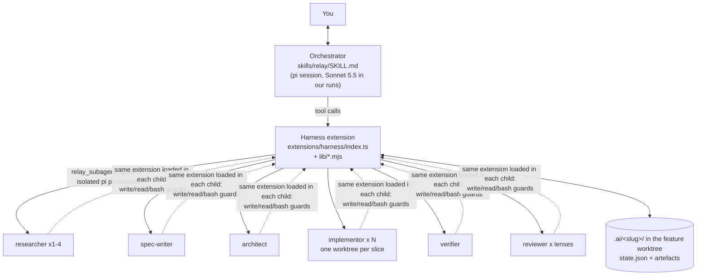

```mermaid
flowchart LR
  R[Requirement] --> B[Baseline checks]
  B --> RS[Research<br/>1-4 parallel topics]
  RS --> SP[Spec + hidden<br/>holdout scenarios]
  SP --> A1{{You approve spec}}
  A1 --> D[Design + slice plan]
  D --> A2{{You approve design}}
  A2 --> I[Implement slices<br/>parallel where independent]
  I --> V[Verify<br/>evidence + holdout score]
  V --> RV[Review<br/>parallel lenses]
  RV --> PR[pr.md + commit<br/>no push]
```

# Relay

**Relay turns a plain-English requirement into a reviewed, tested, ready-to-open pull request.** It coordinates a team of AI specialist agents and has the *harness* (code, not the model) enforce the rules.

It runs on the [pi coding agent](https://github.com/earendil-works/pi) today. A GitHub Copilot port is planned but not built.

## Contents

1. [Why Relay](#why-relay)
2. [Relay in 60 seconds](#relay-in-60-seconds)
3. [Architecture](#architecture)
4. [Before you start: expectations](#before-you-start-expectations)
5. [Prerequisites and install](#prerequisites-and-install)
6. [Your first run](#your-first-run)
7. [The steps, one by one](#the-steps-one-by-one)
8. [Worked example (real excerpts from run 14)](#worked-example-real-excerpts-from-run-14)
9. [Steering, resuming and finishing a run](#steering-resuming-and-finishing-a-run)
10. [Concepts and glossary](#concepts-and-glossary)
11. [Configuration](#configuration)
12. [Safeguards](#safeguards)
13. [Troubleshooting](#troubleshooting)
14. [FAQ](#faq)
15. [Contributing](#contributing)
16. [Repo layout and tests](#repo-layout-and-tests)
17. [Status and known limitations](#status-and-known-limitations)
18. [Copilot port](#copilot-port)

## Why Relay

Asking one AI agent to "build this feature" works for small things. For anything bigger it tends to skip the spec, mark its own homework, forget tests, wander across unrelated files, and leave no trail you can audit or resume. Relay splits the job into roles. Each role writes a small artefact. The harness checks the artefacts and the rules.

## Relay in 60 seconds

You give Relay a requirement. An **orchestrator** (the `relay` skill) walks a fixed pipeline. It hands each step to a **specialist agent** that runs as its own isolated pi process. You approve the spec and the design. Everything is written to `.ai/<slug>/` inside a dedicated git worktree for the feature, and is committed there.



Relay never pushes and never opens a PR. It prepares `pr.md`; you push and run `gh pr create`.

## Architecture



- The **orchestrator** is an LLM following `SKILL.md`. It decides, delegates and talks to you. It cannot approve things for you.
- The **harness extension** provides the tools the orchestrator uses (`harness_state`, `relay_subagent`, `relay_approval`, `relay_checks`, `relay_secret_scan`, `relay_set_passes`) and loads into every child process to enforce guards.
- **Workers** are Markdown agent definitions in `agents/`. Each runs in a fresh pi process with a limited tool set.
- **`lib/*.mjs`** holds the logic (state, gates, policy, git flow, holdouts, fan-out). It has no dependencies and is unit-tested.

## Before you start: expectations

- **Time and cost.** Run 14 (an audit trail plus webhooks feature on a small Node API) took about **36 minutes** and about **4.9M tokens** over 14 delegated calls (from `state.json`: 09:39Z to 10:15Z). It is a real multi-agent run, not a quick edit. That is one data point, not a benchmark.
- **Budget.** The default config caps a run at 60 delegated calls (`budget.maxSubagentCalls`). You can also set `maxTokens`.
- **Approvals.** At the default `gated` level you are asked to approve the spec and the design.

**When not to use Relay**

- Tiny changes (typo, one-line fix, rename): a normal agent session is faster.
- Exploratory or unclear work where you do not yet know what you want.
- Repos with no automated tests and no way to run them: the verifier and test gate lean on runnable checks.
- Anything you cannot afford to spend tokens on.
- Production-critical changes without a human reading the diff. Relay output still needs your review.

## Prerequisites and install

- Node 20+ and git.
- The [pi coding agent](https://github.com/earendil-works/pi) installed, with a provider logged in (`/login` inside pi).
- A target git repo with a way to run its tests (usually `npm test`).

```bash
git clone <this repo> relay && cd relay
npm install
npm run check            # confirms Relay itself is healthy
pi --list-models         # confirm pi can see models for your tiers
```

**Confirm the setup works:** `npm run check` should end with validate OK, all tests passing and a clean typecheck. Then pick models: `pi --list-models` lists what pi can reach.

Edit `relay.config.json` so each tier maps to a model you can use (see [Configuration](#configuration)). The shipped file maps all three tiers to `github-copilot/gpt-6.1-sol`, which only works if your pi can reach that model.

## Your first run

There is one path: run pi in the repo you want to change, with the Relay extension and skill loaded.

```bash
cd /path/to/your/repo                       # a clean git repo with tests
pi        # if installed via `pi install`; from source: pi -e /path/to/relay/extensions/harness/index.ts --skill /path/to/relay/skills/relay
```

Then, inside pi:

```
/skill:relay Add todo archiving and a public HTML dashboard
```

Relay creates branch `relay/<slug>` and a worktree at `<repo>.relay-worktrees/<slug>` (your working copy is untouched), runs the baseline checks, and starts.

**Unattended alternative (the live driver).** `scripts/live-run.mjs` runs the same orchestrator in pi's RPC mode with a single prompt. It is how our test runs were done:

```bash
node scripts/live-run.mjs <repo> <provider/model> "<requirement>" [--log run.log] [--nudges N] [--simulate-approvals]
```

- The model argument is the **orchestrator**. Specialists use `tiers` from `relay.config.json`.
- Approvals are asked on stdin (`Approve? [y/N]`). With no TTY they are denied.
- `--simulate-approvals` auto-approves and logs `[SIMULATED APPROVAL]`. Use it only for unattended tests, because it removes the human check.
- `--nudges N` sends up to N generic "continue" messages if the orchestrator stops early.
- The driver tells the orchestrator not to ask questions, so use interactive pi when you want to steer.

Relay looks for `relay.config.json` in the current directory first, then in the Relay repo. Agents are always read from the Relay repo's `agents/`.

## The steps, one by one

| # | Step | Input | What it does | Output |
|---|---|---|---|---|
| 0 | baseline | repo | runs the repo's own checks (`relay_checks`); asks you if they are already red | `state.json` check results, `evidence/checks-*.log` |
| 1 | requirement | your text | records and sizes it | `requirement.md`, `decisions.md` |
| 2 | research | requirement, `AGENTS.md`, README | read-only mapping; one researcher for small features, 2-4 parallel topic lanes otherwise; every claim cites `file:line`; orchestrator merges and lists conflicts and gaps | `research-<topic>.md` then `research.md` |
| 3 | spec | requirement, research | spec writer produces the spec, visible scenarios and hidden holdouts; spec-lint warns about vague wording | `spec.md`, `features.json`, `holdout/scenarios.json` |
| 4 | spec approval | spec, features | **you** approve or send feedback (max 3 rounds) | `state.approvals.spec` |
| 5 | design | spec, features, research | architect writes slices, file ownership, contracts and test paths | `design.md`, `design.html`, `plan.json` |
| 6 | design review and approval | design, plan | orchestrator compares design to spec; **you** approve (max 3 rounds) | `state.approvals.design` |
| 7 | implement | plan, design, spec | one implementor per slice; independent slices in parallel, each in a sub-worktree, merged back in plan order; test gate | code and tests, `reports/impl-<slice>.md` |
| 8 | verify | spec, features, plan | verifier checks each scenario against the running code, saves evidence, sets `passes`, scores holdouts | `evidence/**`, `reports/verify-*.json`, `holdout/results.json` |
| 9 | review | diff, spec, design | required checks first; one reviewer per lens in parallel; consolidate; re-run only blocking lenses (max 2 rounds) | `reports/review-<lens>.json`, `review-consolidated.json`, `review.md` |
| 10 | pr | everything | writes PR text, runs secret scan, commits `.ai/<slug>/`, marks `done` | `pr.md`, a commit on `relay/<slug>` |

**What to check at each approval**

- *Spec:* every requirement has a concrete, observable scenario in `features.json`. Open questions are flagged, not guessed. Holdout scenarios are deliberately hidden from you too.
- *Design:* slices do not overlap on files, each code slice lists its tests, third-party APIs are faked with a mock or twin (see `skills/relay/references/digital-twins.md`).

## Worked example (real excerpts from run 14)

Run 14 used this requirement on a small Node/Express-style todo API (`sample-api`, outside this repo): *"Add an audit trail and outbound webhooks to the sample API. (1) Audit log ... exposed via GET /todos/:id/history (404 unknown id). (2) Webhooks: POST /webhooks ... (3) GET /stats/activity ..."*. Approvals in this run were **simulated** with `--simulate-approvals`. Excerpts are trimmed.

**1. Approval prompt** (what a human sees in the driver or in pi, title `Approve spec?` or `Approve design?`):

```
[APPROVAL REQUIRED] Approve spec?
<short message from the orchestrator pointing at .ai/<slug>/spec.md and features.json>
Approve? [y/N]
```

(In pi, the same title appears as a confirm dialog. In run 14 the driver logged `[SIMULATED APPROVAL]` for both.)

**2. `spec.md`** (excerpt). Note the honest "unresolved" markers:

```markdown
# Spec: Task item audit trail and outbound webhooks
## Scope
- Store-recorded audit events for successful task item creation, updates, deletion, and archive-like changes.
- `GET /todos/:id/history`, with 404 for a never-known item ID.
...
## Non-goals
- No new archive endpoint or archive field is invented by this specification; the required archive-like operation needs clarification.
```

**3. `features.json`** (excerpt). Each scenario has steps and a `passes` flag that only the verifier may set, with evidence files:

```json
{ "name": "preserve-todo-api",
  "scenarios": [ { "name": "todo-crud-remains-compatible",
    "steps": ["Start a fresh application using the existing createApp() call ...",
              "POST /todos with JSON {\"title\":\"write release notes\"}; expect 201 ...", "..."],
    "passes": true } ] }
```

**4. `plan.json`** (excerpt). Pinned contracts that slices must honour:

```json
{ "contracts": [ { "name": "audit-event", "pinned": true,
    "location": ".ai/todo-audit-webhooks/design.md#audit-event",
    "description": "src/audit.js exports AUDIT_ACTIONS and EVENT_BY_ACTION. AuditEvent has exactly todoId, ISO UTC timestamp, create/update/delete action, and detached before/after snapshots ..." } ],
  "slices": [ "audit-history-activity", "webhook-lifecycle-delivery" ] }
```

The two slices in this run had a dependency between them, so they ran one after the other, not in parallel.

**5. `pr.md`** (excerpt):

```markdown
# Add todo audit trail, webhooks and activity stats
## Traceability (spec item -> scenario -> evidence)
| Spec item | Scenario | Result | Evidence |
| Preserve existing task item HTTP behaviour | todo-crud-remains-compatible | pass | `.ai/todo-audit-webhooks/evidence/todo-crud-remains-compatible.json` |
...
## Verification
- holdout satisfaction: 4/4 (100%; hidden scenarios, not committed; the per-scenario `passes` gate above stays authoritative)
## Review
# Review (consolidated from 4 lenses: correctness, performance, security, tests)
- **minor** `src/webhooks.js:27` [security] Default webhook delivery permits requests to internal destinations
## Caveats
- Archive-like changes are audited as ordinary 'update' (no archive trigger exists in the API).
- Webhook destinations are not restricted (SSRF) — demo only; restrict before exposing to untrusted callers.
```

Run 14 outcome (from its `state.json`): phase `done`, 14 delegated calls, review rounds used 2 of 2, both slices `merged`. It used one researcher.

## Steering, resuming and finishing a run

**Answer clarifying questions.** Reply in the pi chat. Relay records the question in `state.json` (`pendingQuestions`) and your answer in `decisions.md` so it survives a restart.

**Request changes to the spec or design.** Decline the approval prompt and say what to change ("add an error case for empty input"). Relay re-delegates with your feedback, up to 3 rounds per gate, then escalates.

**Resume an interrupted run.**

```
/skill:relay --resume [slug]
```

With no slug it lists `relay/*` worktrees. Relay re-attaches to the worktree, checks artefact hashes and re-runs interrupted steps (details: `skills/relay/references/resume.md`). Worktree re-attach is unit-tested; a full kill-and-resume of a real run has **not** been done live.

**Finish: push and open the PR yourself.**

```bash
cd <repo>.relay-worktrees/<slug>
git log --oneline
cat .ai/<slug>/pr.md                 # PR text and caveats
git push -u origin relay/<slug>
gh pr create --title "<title>" --body-file .ai/<slug>/pr.md
```

Relay never runs these. The `gh pr create` step is **untested** here: no real PR has been opened from a Relay branch. Read the diff before you push. The holdout directory is never committed. Clean up with `git worktree remove <path>`.

## Concepts and glossary

- **Slice** – one unit of implementation work in `plan.json`: an id, the files it owns, its spec items, its tests and its dependencies. One implementor handles one slice and may only write files the slice owns.
- **Wave / parallel slices** – slices with disjoint files and no dependencies run at the same time, each in its own sub-worktree (`relay/<slug>--<slice>`), then merge back in plan order.
- **Worktree** – a second checkout of your repo on its own branch (`relay/<slug>`) at `<repo>.relay-worktrees/<slug>`. All work and `.ai/<slug>/` live there.
- **Lane** – a named parallel task (a research topic or a review lens).
- **Lens** – one review perspective (correctness, security, tests, performance by default; accessibility for UI diffs; api-contract for endpoint changes). Each lens is a separate reviewer writing `reports/review-<lens>.json`.
- **Holdout** – hidden end-to-end scenarios (`holdout/scenarios.json`). Only the verifier may read them; implementors and reviewers never see them, so they cannot tune the code to the tests.
- **Satisfaction score** – the fraction of holdout scenarios that pass (run 14: 4/4). Reported next to, not instead of, the per-scenario `passes` gate, which stays authoritative. `satisfactionThreshold` (default 1) must be met to enter review.
- **Tier** – a capability level (`strong`, `mid`, `cheap`) that an agent declares. `relay.config.json` maps tiers to models, so no model IDs are in agent files.
- **Gate** – a check the harness runs before a phase change (`set_phase`): schemas valid, approvals recorded, slices merged, evidence present, required checks green on HEAD.
- **Guard** – a rule enforced when an agent reads, writes or runs bash.
- **Autonomy level** – how many approvals Relay asks for (`supervised`, `gated`, `autonomous`).
- **Digital twin / mock** – a fake of a third-party API used so tests never call the real one.

### The agents

| Agent | Job | Can write |
|---|---|---|
| `relay` (orchestrator) | Runs the pipeline, calls harness tools, merges research and review output | `.ai/<slug>/` coordination files |
| `relay-researcher` | Read-only investigation of one topic | `research-<topic>.md` |
| `relay-spec-writer` | Spec, `features.json`, holdout scenarios | spec files, `holdout/scenarios.json` |
| `relay-architect` | Design and slice plan | `design.md`, `design.html`, `plan.json` |
| `relay-implementor` | Code and tests for one slice | only the files its slice owns |
| `relay-verifier` | Checks with evidence; sets `passes`; scores holdouts | `evidence/**`, `reports/verify-*.json`, `holdout/results.json` |
| `relay-reviewer` | Reviews the diff through one lens | `reports/review-<lens>.json` |

### What ends up in `.ai/<slug>/`

```
.ai/<slug>/
  state.json        phase, worktree + branch, approvals, counters, usage
  requirement.md    decisions.md    research.md (+ research-<topic>.md)
  spec.md           features.json   design.md   design.html   plan.json
  evidence/         proof for each scenario and each check run
  reports/          impl-*.md, verify-*.json, review-<lens>.json, review.md
  pr.md             final PR text and traceability table
  holdout/          hidden scenarios + results (never committed)
  _quarantine/      stray files moved out of the way (not committed)
```

## Configuration

`relay.config.json` (this repo's copy is the default):

```json
{
  "reviewLenses": ["correctness", "security", "tests", "performance"],
  "autonomy": "gated",
  "requiredChecks": ["test"],
  "satisfactionThreshold": 1,
  "budget": { "maxSubagentCalls": 60, "maxTokens": 8000000 },
  "tiers": { "strong": "<provider/model>", "mid": "<provider/model>", "cheap": "<provider/model>" }
}
```

| Key | Meaning |
|---|---|
| `tiers` | tier to model. Required for specialists to run on a model you choose |
| `reviewLenses` | which lenses run. Accessibility and api-contract are added automatically for UI or endpoint diffs |
| `autonomy` | `supervised` (spec, design and PR text approved by you), `gated` (default: spec and design), `autonomous` (none; `relay_approval` auto-approves and says so). Schema, check, holdout and review gates apply at every level |
| `requiredChecks` | checks that must have run green on the current HEAD before review/PR (default `["test"]`; may include `lint`, `sast`) |
| `satisfactionThreshold` | minimum holdout pass fraction to enter review (default 1) |
| `budget` | optional `maxSubagentCalls` and `maxTokens`; delegation is refused once exceeded |

The `maxTokens` value above is an example; it is not set in the shipped file.

**Models on another machine.** Run `pi --list-models`. An unlisted id is still accepted with a "not found ... using custom model id" warning and works if the provider serves it. If the provider rejects pi's default API, add a custom entry in `~/.pi/agent/models.json`. Our live runs needed one for `claude-sonnet-5.5`:

```json
{ "providers": { "github-copilot": { "models": [
  { "id": "claude-sonnet-5.5", "api": "openai-completions", "baseUrl": "https://api.githubcopilot.com",
    "reasoning": false, "input": ["text"], "contextWindow": 200000, "maxTokens": 32000,
    "headers": { "User-Agent": "GitHubCopilotChat/0.35.0", "Editor-Version": "vscode/1.107.0",
                 "Editor-Plugin-Version": "copilot-chat/0.35.0", "Copilot-Integration-Id": "vscode-chat" } } ] } } }
```

This is what worked here, not a guarantee elsewhere. Never commit tokens.

## Safeguards

The harness enforces these in `extensions/harness/` and `lib/`. How far each one has been proven is in [Status and known limitations](#status-and-known-limitations); a guard being listed here does **not** mean it was exercised live.

- **One worktree per feature.** Branch `relay/<slug>` in `<repo>.relay-worktrees/<slug>`.
- **Write guards.** A role can only write its allowed files. `state.json`, `AGENTS.md`, `README.md`, `.env` and `.git` are protected. `git push` is blocked. Only implementors may commit.
- **Ownership revert.** After a child run, the harness diffs against the pre-run HEAD and reverts out-of-ownership changes, including ones made through `bash`.
- **Bash path confinement.** A pattern-based block on bash writes outside the worktree. Heuristic: it can be bypassed.
- **Holdouts.** Read guards block every role except the verifier and spec-writer, including bash commands that mention the directory. The orchestrator is told never to read or quote them. Obfuscated reads (for example string-built paths) are not reliably caught.
- **Test gate.** An implementor slice that changes code without touching tests fails and is retried with feedback. Implementors must map each spec item in their slice to a named test (integration/e2e for API, UI or cross-module slices) and report it in `reports/impl-<slice>.md`. `plan.json` slices that list spec items but no `tests` are rejected at the design gate. The mapping report itself is instruction-only, not machine-checked.
- **Only you approve.** Approvals go through `relay_approval`. Only the verifier can set `passes`, and only with evidence. At `autonomous` level approvals are skipped by design.
- **Content gates.** `set_phase` checks schemas, recorded approvals, merged slices, evidence for each passing scenario and the review report, not just that files exist.
- **Required checks.** `requiredChecks` must be green on the current HEAD before review or PR.
- **Caps.** Implement, verify and review loops are counted and capped. Review lens re-runs are limited to 2 rounds. Exceeding a cap escalates to you.
- **Budget and usage.** Every delegated call records calls, turns and tokens in `state.usage`. Optional caps refuse further delegation.
- **Stray-file quarantine.** Files in `.ai/<slug>/` outside the allowed layout are moved to `_quarantine/` and not committed.
- **Secret scan.** Runs before the final commit. It is a pattern scan, not a guarantee.

## Troubleshooting

**A cap was hit** (`CAP EXCEEDED: escalate to the user` or `budget exceeded`). Relay stops and asks you. Look at the latest report in `.ai/<slug>/reports/` to see why the loop did not converge. To continue, either fix the cause by hand in the worktree or raise the cap (`budget.*` in `relay.config.json`; loop caps are set by the orchestrator when it opens each counter) and resume.

**Baseline is red.** Your repo's tests fail before Relay changes anything. Relay asks whether to continue. Fix the repo first: Relay's gates compare against green, and a red baseline makes failures ambiguous.

**Discard a run.** There is no discard command. Remove the worktree and branch yourself:

```bash
git worktree remove --force <repo>.relay-worktrees/<slug>
git branch -D relay/<slug>
git branch --list "relay/<slug>--*"      # delete leftover slice branches too, if any
```

**pi cannot find the model.** Check the id with `pi --list-models` and that the provider is logged in. An id pi does not list may still work as a custom id; if the provider returns an API error, add a `models.json` entry (see [Configuration](#configuration)). Check every tier in `relay.config.json`, not just the orchestrator.

**The run looks stuck.** The orchestrator sometimes stops early. In pi, type `continue`. With the driver, use `--nudges N`. If you get `lock held by pid ...`, another process owns the run; if that process is dead, confirm and resume with takeover (Relay asks). Check `state.json` `phase` and `pendingQuestions` to see where it is waiting.

**A child was rejected** (`FAILED`, `MISSING REQUIRED OUTPUTS`, plan errors). The harness tells the orchestrator what was wrong and it re-delegates. This is normal and counted against the caps.

## FAQ

**Does Relay push or open a PR?** No. It commits to `relay/<slug>` and writes `pr.md`.

**Does it change my working copy?** No. Work happens in a separate worktree. It does need to read your repo and `git worktree add` a new one.

**Which models does it use?** Whatever you map in `tiers`, plus the model you start pi with for the orchestrator. We ran Sonnet 5.5 for orchestration and GPT-6.1 Sol for specialists.

**Why can't implementors see the holdout scenarios?** So they cannot overfit to them. Only the verifier reads them and reports a score.

**Can the model approve its own spec?** Not through `relay_approval`, which is a human prompt. At `autonomous` autonomy approvals are skipped on purpose, and in simulated runs the driver auto-approves.

**Does it work without tests in the repo?** Poorly. The test gate and required checks expect runnable tests.

## Contributing

First read `AGENTS.md`, then run `npm install` and `npm run check`.

**Add an agent.**
1. Create `agents/relay-<name>.md` with frontmatter `name` (equal to the filename), `description`, `tools` and `tier`. No model IDs.
2. Teach the harness the role: required outputs and write/read rules live in `lib/policy.mjs` (`requiredOutputs`, `checkWrite`, `checkRead`).
3. Reference it from `skills/relay/SKILL.md` where the orchestrator should use it.
4. Add tests in `test/` and run `npm run check` (it lints the frontmatter).

**Add a review lens.**
1. Add its checklist to `LENS_CHECKLISTS` in `lib/fanout.mjs`.
2. To make it automatic for certain diffs, extend `reviewLenses()` there. To make it always on, add it to `reviewLenses` in `relay.config.json`.
3. Lens names must be lowercase-hyphenated (`LANE_RE`). The lens JSON follows `schemas/review-lens.schema.json`.
4. Add a unit test.

**Add a check** (for example `lint`, `sast`). `relay_checks` runs the commands in `state.checks`; it autodetects `build`, `typecheck`, `lint`, `test` from `package.json` scripts and recognises `sast`. Add the check name to `requiredChecks` in `relay.config.json` to make it a gate. The orchestrator can set commands with `harness_state action=checks`.

**Change a file contract.** Schemas in `schemas/` are the contract for `.ai/<feature>/` files. Change them together with `lib/state.mjs`, the fixtures and the tests. Put logic in `lib/*.mjs` and keep `extensions/harness/index.ts` thin. pi APIs must come from the installed `@earendil-works/pi-coding-agent` types and docs.

## Repo layout and tests

| Path | Purpose |
|---|---|
| `skills/relay/` | Orchestrator skill. `references/` has brief, workflow, resume, scenario and digital-twin guidance |
| `agents/` | The agent definitions |
| `extensions/harness/` | pi extension: `relay_subagent` (single, parallel, chain), `harness_state`, `relay_approval`, `relay_checks`, `relay_secret_scan`, guards |
| `lib/` | Dependency-free ESM logic shared by the extension and tests |
| `schemas/` | JSON Schemas: state, features, plan, verifier report, review lens |
| `templates/` | brief, spec, design, lessons |
| `scripts/` | `validate.mjs`, `live-run.mjs`, `gen-copilot-agents.mjs` |
| `docs/copilot-port.md` | Copilot port plan and concept mapping |

```bash
npm run check   # validate (frontmatter + schemas) + node --test test/ + typecheck
```

## Status and known limitations

Relay has been run live in pi several times against small sample Node APIs, with Sonnet 5.5 as orchestrator and GPT-6.1 Sol as specialists. The most recent documented run (run 14, above) reached `done` with no nudges. Honest scope of the evidence:

- **Seen working live:** the pipeline through to a committed `pr.md`; parallel review lenses with citations; a blocking review finding fixed and the affected lens re-run; holdout scoring; the bash outside-worktree write block; the holdout read block against an implementor and against a reviewer's `read` tool; usage recording.
- **Unit-tested only, or checked outside a real model run:** the ownership revert and the test-gate retry through a real child agent; obfuscated holdout-read variants; the 2-round lens cap refusal; budget caps; autonomy levels; required `sast`/`lint` checks; the Windows `node_modules` junction; spec lessons; the digital-twin design gate; worktree re-attach on resume.
- **Not exercised in every run:** parallel researcher lanes and parallel slices depend on the orchestrator's and architect's choices. Run 14 used one researcher and two dependent (sequential) slices.
- **Approvals in the live runs were simulated** with `--simulate-approvals`. The stdin approval mode exists but a human-in-the-loop run has not been done end to end.
- **Not tested at all:** resuming a killed real run, and pushing and opening a PR from a Relay branch.
- The bash write guards and the holdout read guard are **pattern based** and can be obfuscated around (for example `python -c "open('../x','w')"`). The ownership revert is the backstop for writes inside the repo. Reads of ignored or untracked paths are not policed.
- Evidence comes from a few small sample repos and one platform (Windows). Results elsewhere are unknown. Token use and duration vary between runs.

## Copilot port

Relay can be installed into GitHub Copilot (CLI and VS Code agent mode). It is a weaker host than pi: the orchestrator follows Relay's rules by instruction, and only a `preToolUse` hook enforces anything.

### Install

```
npm run install:copilot -- --target repo --dry-run    # preview, writes nothing
npm run install:copilot -- --target repo              # into <cwd>/.github (agents, skills/relay, hooks, relay runtime)
npm run install:copilot -- --target home              # into ~/.copilot (or $COPILOT_HOME)
npm run install:copilot -- --target plugin --dest dist/copilot-plugin   # plugin.json package, then: copilot plugin install <dir>
```

Options: `--dest <dir>`, `--no-guard` (skip the hook). Then start with `copilot --agent relay`.

Tiers map to models through `copilotTiers` and `copilotOrchestrator` in `relay.config.json` (default: orchestrator `claude-sonnet-5.5`, specialists `gpt-6.1-sol`). Your Copilot plan or admin may override `model:`.

### Enforcement: pi vs Copilot

| Rule | pi | Copilot |
|---|---|---|
| Holdout/read/write guards | extension | hook, **subagents only** (root session has no `agentType`; set `RELAY_ROLE=relay` to guard it) |
| bash path confinement, `git push`/non-implementor commit block | extension | hook |
| Per-slice ownership revert | extension | instruction only (hook cannot see slice globs) |
| Test gate, phase gates, budget, review round cap, autonomy | extension (`relay_*` tools) | instruction only; state.json edited by hand |
| Workers as separate processes, parallel slice worktrees | yes | no; uses Copilot's `task`/`agent` subagents |

Details: [`skills/relay/references/copilot-host.md`](skills/relay/references/copilot-host.md), [`docs/copilot-port.md`](docs/copilot-port.md).

### Verified vs unverified

Verified live with the `copilot` CLI: skills are discovered from `.github/skills`; agents from `.github/agents`; the `relay-reviewer`/`relay-implementor` agents run as subagents; the `preToolUse` hook fires with the expected payload and identifies subagent roles; `copilot plugin install` of the generated plugin succeeds (CLI reported "Installed 1 skill"; agent loading from the plugin was not confirmed). Verified by unit tests: translation, tier mapping, installer and dry-run, the installed hook denying a reviewer reading holdout, and the guard decision matrix.

Unverified: an end-to-end Relay run on Copilot; hook denial live (in probes the model refused on its own, so no tool call reached the hook); the Sonnet orchestrator model (an admin setting forced `gpt-6.1-sol` here); VS Code agent mode; marketplace publishing (direct plugin installs are deprecated by Copilot).
