# Relay

**Relay turns a plain-English requirement into a reviewed, tested, ready-to-open pull request** by coordinating a team of AI specialist agents, with guard rails that a single chat agent doesn't have.

It runs on the [pi coding agent](https://github.com/earendil-works/pi) today. A GitHub Copilot port is planned but not built (see [Status](#status-and-known-limitations)).

## The problem

Asking one AI agent to "build this feature" works for small things. For anything bigger it tends to: skip the spec, mark its own homework, forget tests, wander across unrelated files, and leave no trail you can audit or resume. Relay splits the job into roles, makes each role write a small artefact, and has the *harness* (not the model) enforce the rules.

## How it works in 60 seconds

```mermaid
flowchart LR
  R[Requirement] --> B[Baseline checks]
  B --> RS[Research<br/>1-4 parallel topics]
  RS --> SP[Spec + hidden<br/>holdout scenarios]
  SP --> A1{{You approve spec}}
  A1 --> D[Design + slice plan]
  D --> A2{{You approve design}}
  A2 --> I[Implement slices<br/>parallel where independent]
  I --> V[Verify<br/>evidence + holdout score]
  V --> RV[Review<br/>parallel lenses]
  RV --> PR[pr.md + commit<br/>no push]
```

You give Relay a requirement. An **orchestrator** (the `relay` skill) walks a fixed pipeline and delegates each step to a **specialist agent** that runs as its own isolated pi process. You approve the key gates. Everything is written to `.ai/<slug>/` inside a dedicated git worktree for the feature.



Plain-language walkthrough:

1. **Baseline** – run the repo's own checks (e.g. `npm test`) so Relay knows what "green" means before touching anything.
2. **Research** – read-only researchers map the code. Small feature: one researcher. Larger: 2-4, each on a topic (data layer, API, UI, tests). Every claim must cite `file:line`. The orchestrator merges them into `research.md` and lists conflicts and gaps instead of smoothing them over.
3. **Spec** – a spec writer produces `spec.md`, `features.json` (visible scenarios) and **holdout** scenarios that nobody but the verifier may see. A spec-lint step warns about vague or untestable wording. **You approve.**
4. **Design** – an architect writes `design.md` and `plan.json`: slices, owned files, dependencies, and a test path for each code slice. The orchestrator reviews it, **you approve**.
5. **Implement** – implementors build slices. Independent slices run in parallel, each in its own sub-worktree, then merge back in plan order.
6. **Verify** – an independent verifier checks every scenario against the running code, saves evidence, and is the only role that can mark a scenario as passing. It also runs the hidden holdouts.
7. **Review** – one reviewer per lens (correctness, security, tests, performance by default) runs in parallel. Findings need a `file:line` citation or they are dropped. Blocking findings go back to implementors and only the affected lenses re-run.
8. **PR** – Relay writes `pr.md` (summary, traceability table, evidence, review outcome, caveats), runs a secret scan, commits `.ai/<slug>/` on the feature branch and marks the run `done`. **It never pushes or opens a PR**; you do that with the `gh pr create` text it prepares.

## The agents

| Agent | Job | Can write |
|---|---|---|
| `relay` (orchestrator) | Runs the pipeline, calls the harness tools, merges research and review output | `.ai/<slug>/` coordination files |
| `relay-researcher` | Read-only investigation of one topic | `research-<topic>.md` |
| `relay-spec-writer` | Spec, `features.json`, holdout scenarios | spec files, `holdout/scenarios.json` |
| `relay-architect` | Design and slice plan | `design.md`, `plan.json` |
| `relay-implementor` | Code and tests for one slice | only the files its slice owns |
| `relay-verifier` | QA-style checks with evidence; sets `passes`; scores holdouts | `evidence/**`, `reports/verify-*.json`, `holdout/results.json` |
| `relay-reviewer` | Reviews the diff through one lens | `reports/review-<lens>.json` |

Agents are plain Markdown files in `agents/` (frontmatter: `name`, `description`, `tools`, `tier`). They declare a **tier**, never a model ID.

## What ends up in `.ai/<slug>/`

```
.ai/<slug>/
  state.json        phase, worktree + branch, approvals, counters, usage
  requirement.md    decisions.md    research.md (+ research-<topic>.md)
  spec.md           features.json   design.md   plan.json
  evidence/         proof for each scenario and each check run
  reports/          impl-*.md, verify-*.json, review-<lens>.json, review.md
  pr.md             final PR text and traceability table
  holdout/          hidden scenarios + results (never committed)
```

Because it is committed with the feature, a run can be resumed on any machine (`/skill:relay --resume`).

## Safeguards

These are enforced by the extension in `extensions/harness/`, not by asking the model nicely.

- **One worktree per feature** – branch `relay/<slug>` in `<repo>.relay-worktrees/<slug>`. Your working copy is untouched.
- **Write guards** – a role can only write its allowed files; `state.json`, `AGENTS.md`/`README.md`, `.env` and `.git` are protected; `git push` is blocked; only implementors may commit.
- **Ownership revert** – after every agent run the harness diffs against the pre-run HEAD and reverts (and reports) out-of-ownership changes, even ones made through `bash`.
- **Bash path confinement** – heuristic block on bash writes outside the worktree.
- **Holdouts** – hidden end-to-end scenarios only the verifier may read. Read guards block every other role, including bash commands that mention the directory. The verifier reports a **satisfaction score** (fraction passing); `satisfactionThreshold` (default 1) must be met to enter review. The hard `passes` gate stays authoritative.
- **Test gate** – an implementor slice that changes code without touching tests fails and is retried with feedback.
- **Only the user approves** – approvals go through `relay_approval` (a UI confirm). Only the verifier can set `passes`, and only with existing evidence.
- **Content gates** – `set_phase` checks schemas, recorded approvals, merged slices, verifier evidence for each passing scenario and the review report, not just file existence.
- **Required checks** – `requiredChecks` (default `["test"]`) must be green on the current HEAD before review/PR.
- **Caps** – implement, verify and review loops are counted and capped; review lens re-runs are limited to 2 rounds; exceeding a cap escalates instead of looping.
- **Budget** – optional `maxSubagentCalls` / `maxTokens`; every delegated call records calls, turns and tokens in `state.usage`.
- **Stray-file quarantine** – files in `.ai/<slug>/` outside the allowed layout are moved to `_quarantine/` and not committed.
- **Secret scan** – runs before the final commit.

### Autonomy levels

`relay.config.json` → `"autonomy"`:

| Level | Human approvals |
|---|---|
| `supervised` | spec, design and PR text |
| `gated` (default) | spec and design |
| `autonomous` | none (`relay_approval` auto-approves and says so) |

Schema, check, holdout and review gates apply at every level.

## Quick start (pi)

Prerequisites: Node 20+, git, a pi install with a logged-in provider.

```bash
npm install
cd /path/to/your/repo
pi -e /path/to/relay/extensions/harness/index.ts --skill /path/to/relay/skills/relay
# then inside pi:
/skill:relay Add todo archiving and a public HTML dashboard
/skill:relay --resume [slug]
```

Agents are read from `agents/`. `relay.config.json` is looked up in the current directory, then in the Relay repo.

### Configuration: `relay.config.json`

```json
{
  "reviewLenses": ["correctness", "security", "tests", "performance"],
  "autonomy": "gated",
  "requiredChecks": ["test"],
  "satisfactionThreshold": 1,
  "budget": { "maxSubagentCalls": 60 },
  "tiers": { "strong": "<provider/model>", "mid": "<provider/model>", "cheap": "<provider/model>" }
}
```

- `tiers` maps each agent's tier to a model. No model IDs are hardcoded in agent files.
- `reviewLenses` sets the review lenses (accessibility and API-contract lenses are for UI / endpoint diffs).
- `requiredChecks` may include `lint` and `sast`.

### Models on another machine

Check what pi can reach with `pi --list-models`. An unlisted id is still accepted with a "not found … using custom model id" warning and works if the provider serves it. If the provider rejects pi's default API, add a custom entry in `~/.pi/agent/models.json`; this repo's live runs needed one for `claude-sonnet-5.5`:

```json
{ "providers": { "github-copilot": { "models": [
  { "id": "claude-sonnet-5.5", "api": "openai-completions", "baseUrl": "https://api.githubcopilot.com",
    "reasoning": false, "input": ["text"], "contextWindow": 200000, "maxTokens": 32000,
    "headers": { "User-Agent": "GitHubCopilotChat/0.35.0", "Editor-Version": "vscode/1.107.0",
                 "Editor-Plugin-Version": "copilot-chat/0.35.0", "Copilot-Integration-Id": "vscode-chat" } } ] } } }
```

Authenticate first (`pi`, then `/login`). This is what worked here, not a guarantee elsewhere. Never commit tokens.

### Live driver

```bash
node scripts/live-run.mjs <repo> <provider/model> "<requirement>" [--log f] [--nudges N] [--simulate-approvals]
```

Runs the orchestrator in pi RPC mode. Approvals are asked on stdin (`Approve? [y/N]`; denied with no TTY). `--simulate-approvals` auto-approves and logs `[SIMULATED APPROVAL]`; use it only for unattended tests.

## How to use Relay

### Start a run

Interactive (recommended), from the repo you want to change:

```bash
pi -e /path/to/relay/extensions/harness/index.ts --skill /path/to/relay/skills/relay
/skill:relay Add todo archiving and a public HTML dashboard
```

Scripted, via the live driver (RPC mode, one prompt, no back-and-forth):

```bash
node scripts/live-run.mjs /path/to/your/repo github-copilot/claude-sonnet-5.5 "Add todo archiving" --log run.log
# add --simulate-approvals only for unattended tests; --nudges N sends generic "continue" nudges
```

The first model argument is the orchestrator; specialists use `tiers` from `relay.config.json`. The driver tells the orchestrator not to ask questions, so use interactive pi when you want to steer.

### A worked session

1. **You type** `/skill:relay <requirement>`. Relay creates branch `relay/<slug>` and a worktree `<repo>.relay-worktrees/<slug>`, and runs the baseline checks. *Check:* it tells you the worktree path; if baseline tests are red it asks whether to continue.
2. **Research** runs. If something can't be answered from the code, Relay asks you (a pending question, saved in `state.json`). *Check:* `research.md` and its conflicts/gaps list.
3. **Spec ready – approval prompt #1.** Read `.ai/<slug>/spec.md` and `features.json` (the visible scenarios). The hidden holdout scenarios are deliberately not shown to you or the implementors. Approve, or decline with feedback ("add an error case for X", "drop Y"); Relay re-runs the spec writer. Up to 3 rounds. *Check:* every requirement has a concrete, observable scenario.
4. **Design ready – approval prompt #2.** Read `design.md` (and `design.html`) and `plan.json`: slices, the files each owns, which can run in parallel. Approve or send changes (3 rounds). *Check:* slices don't overlap, each code slice has tests.
5. **Implement, verify, review** run without prompts. Failures loop back to implementors within the caps; anything past a cap is escalated to you. *Check:* `reports/verify-*.json`, `evidence/`, `reports/review.md`.
6. **PR draft.** Relay writes `pr.md`, scans for secrets, commits `.ai/<slug>/` on the feature branch and sets the run to `done`. It does not push. At `supervised` autonomy you also approve the PR text first.

### What each step takes in and produces

| Step | Input | What it does | Output |
|---|---|---|---|
| baseline | repo | runs the repo's own checks | `state.json` check results |
| requirement | your text | records it and your decisions | `requirement.md`, `decisions.md` |
| research | requirement, `AGENTS.md`, README | read-only mapping with `file:line` citations; merged | `research-<topic>.md` → `research.md` |
| spec | requirement, research | spec, visible and holdout scenarios, spec-lint warnings | `spec.md`, `features.json`, `holdout/scenarios.json` |
| design | spec, features, research | slices, ownership, test paths | `design.md`, `design.html`, `plan.json` |
| implement | plan, design, spec | one implementor per slice in a sub-worktree; merge back; test gate | code + tests, `reports/impl-*.md` |
| verify | spec, features, plan | checks every scenario, saves proof, scores holdouts | `evidence/**`, `reports/verify-*.json`, `holdout/results.json` |
| review | diff, spec, design | one reviewer per lens; consolidate; re-run blocking lenses (max 2 rounds) | `reports/review-<lens>.json`, `review.md` |
| pr | everything | writes PR text, scans secrets, commits | `pr.md`, commit on `relay/<slug>` |

### Steering a run

- **Answering questions:** reply in the pi chat; Relay records the answer in `decisions.md` so it survives a restart.
- **Changing the spec or design:** decline the approval prompt and say what to change, or edit the chat reply ("also cover empty input"). Relay re-delegates with your feedback.
- **Resuming:** `/skill:relay --resume [slug]` (no slug lists `relay/*` worktrees). Relay re-attaches to the worktree, checks artefact hashes, re-runs interrupted steps and re-asks open questions or approvals. Details: `skills/relay/references/resume.md`.

### Finish: push and open the PR yourself

Relay stops with a committed branch. Review it, then:

```bash
cd <repo>.relay-worktrees/<slug>
git log --oneline            # check the commits
cat .ai/<slug>/pr.md         # PR title/body and the suggested gh command
git push -u origin relay/<slug>
gh pr create --title "<title>" --body-file .ai/<slug>/pr.md
```

`pr.md` includes the traceability table, check results, verification evidence, review outcome and caveats. The holdout directory is never committed. Remove the worktree afterwards with `git worktree remove <path>`.

## Repo layout

| Path | Purpose |
|---|---|
| `skills/relay/` | Orchestrator skill; `references/` has brief, workflow, resume, scenario and digital-twin guidance |
| `agents/` | The agent definitions above |
| `extensions/harness/` | pi extension: `relay_subagent` (single/parallel/chain isolated pi processes), `harness_state`, `relay_approval`, `relay_checks`, `relay_secret_scan`, guards |
| `lib/` | Dependency-free ESM logic shared by the extension and tests (state, gates, policy, gitflow, holdout, fanout, budget, lint) |
| `schemas/` | JSON Schemas: state, features, plan, verifier report, review lens |
| `templates/` | brief, spec, design, lessons |
| `scripts/` | `validate.mjs`, `live-run.mjs`, `gen-copilot-agents.mjs` |
| `docs/copilot-port.md` | Copilot port plan and concept mapping |

## Tests

```bash
npm run check   # validate (frontmatter + schemas) + node --test test/ + typecheck
```

## Status and known limitations

Relay has been run live end to end in pi several times against a small sample Node API, with Sonnet 5.5 as orchestrator and GPT-6.1 Sol as specialists. The latest two runs reached `done` with no nudges. Honest scope of that evidence:

- **Live-verified:** the full pipeline to a committed `pr.md`; parallel review lenses; a blocking review finding fixed and re-run on the affected lens; holdout scoring; the bash outside-worktree write block; the holdout read block for an implementor and a reviewer's `read` tool; token/call usage recording.
- **Unit-tested only, or checked outside a model:** the ownership revert and test-gate retry through a real child agent; the obfuscated holdout-read variants; the 2-round lens cap refusal; budget caps; autonomy levels; required `sast`/`lint` checks; the Windows `node_modules` junction; spec lessons; the digital-twin design gate.
- **Not exercised in every run:** parallel researcher lanes and parallel slices depend on the orchestrator and architect's choices; the latest run used one researcher and sequential slices.
- Approvals in the live runs were **simulated** with `--simulate-approvals`.
- The bash write guards and holdout read guard are **text/pattern based** and can be obfuscated around (for example `python -c "open('../x','w')"`). The ownership revert is the backstop for in-repo writes.
- Reads of ignored or untracked paths are not policed.
- Tested on one small sample repo and one platform (Windows); results elsewhere are unknown.

## Copilot port

Not implemented. `node scripts/gen-copilot-agents.mjs` writes `.github/agents/*.agent.md`, but Relay's harness tools have no Copilot equivalent yet, so the orchestrator and guards do not run there. The plan and concept mapping are in [`docs/copilot-port.md`](docs/copilot-port.md).
